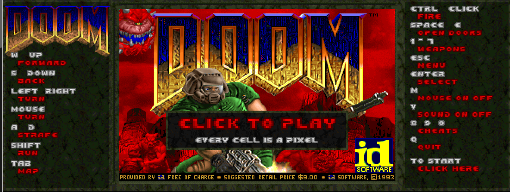
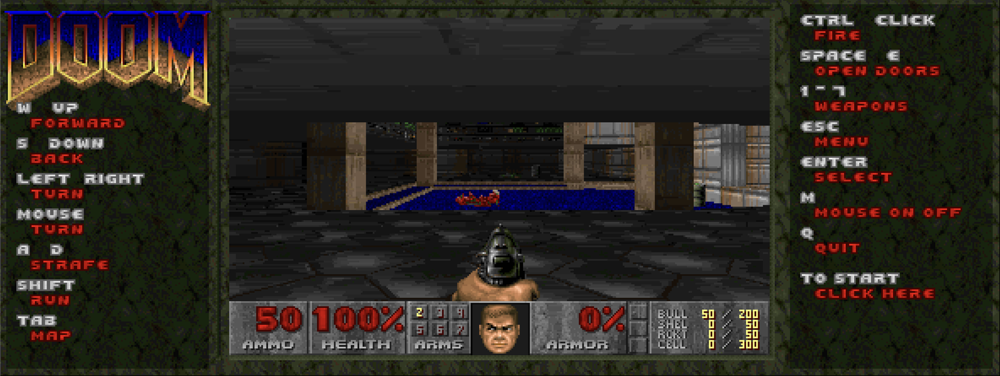

# DOOM in an Excel sheet

The real DOOM engine running inside a single Excel workbook. Every cell is a pixel. No add-ins, no DLLs, no helper programs: one `.xlsm` file and Excel.



**[Download ExcelDoom.xlsm](https://github.com/NickCason/excel-doom/releases/latest/download/ExcelDoom.xlsm)** (7.7 MB, includes the shareware episode)

- **It is the original engine**, compiled from the id Software C source and translated to VBA by a script. Nothing was rewritten by hand.
- **The picture is the sheet.** 320 × 200 cells, each one filled with a colour, repainted every frame.
- **It is checked, not just played.** The workbook has a self-check that must reproduce 82 reference frames exactly, and does.



## Status

| | Excel for Mac 16.x, Apple Silicon | Excel for Windows, 64-bit |
|---|---|---|
| Engine self-check (82 frames) | Passed for the first public version; not rerun since | Passes |
| Frame rate, standing still / moving | About 35 / 10–12 fps | About 45 / 10 fps |
| Sound effects | No | Yes, one at a time |
| Mouse look | Yes | Off by default, untested |
| Tested | By its author, for the first public version | One machine, with the automated checks below |

Everything added after the first public version (the title-screen start, cheat keys, the Cheat Sheet and Checklist tabs) is written for both platforms and passes the build's check for each, but **has only been run on Windows**. See [docs/WINDOWS.md](docs/WINDOWS.md).

32-bit Excel, Excel Online, Numbers and LibreOffice are not supported.

This is an experiment, not a product. No music. No saving. It starts directly on E1M1.

## How to play

1. Download the workbook and open it in desktop Excel.
2. Allow macros.
   - **Mac:** choose *Enable Macros* when Excel asks.
   - **Windows:** Office blocks macros in downloaded files. Close the file, right-click it, choose *Properties*, tick *Unblock*, then open it and choose *Enable Content*.
3. The workbook opens on the title screen. Click it. (Or run the macro `PlayDoom`.)
4. Press **Q** to quit back to Excel. Click anywhere on the picture to play again.

| Key | Action |
|---|---|
| W / S or Up / Down | Forward / back |
| Left / Right | Turn |
| Mouse (Mac) | Turn; left click fires |
| A / D | Strafe |
| Ctrl | Fire |
| Space or E | Open doors, use |
| Shift | Run |
| 1–7 | Weapons |
| Tab | Map |
| Esc, Enter, Y, N | Menu: new game, difficulty, sound volume |
| M | Mouse look on/off |
| P | Pause |
| V | Sound on/off (Windows) |
| 8 / 9 / 0 | Cheats: god mode / all weapons, keys and ammo / walk through walls |
| Q | Quit |

The cheat keys type the original codes (`IDDQD`, `IDKFA`, `IDSPISPOPD`) into the engine for you. They cannot be typed by hand: most of their letters are not game keys here, and Q quits.

On Mac, mouse look pins the pointer to the top of the screen while Excel is in front. Press **M** to free it, or switch apps.

### The three tabs

| Tab | What it is |
|---|---|
| **DOOM** | The game. When no game is running it shows a click-to-play sign over the title screen or over the last frame. |
| **Cheat Sheet** | The cheat keys, the controls, and a few lines on what you are looking at. |
| **Checklist** | A deliberately dull to-do list. Its last task is *Make this spreadsheet less boring*; ticking its box starts a game, and after each game the row records kills, items, secrets, time and map. |

## What the macros do

Macros are the whole point here, so it is fair to ask what they touch.

- They change cell colours on the game sheet, and the zoom and gridline settings of that window.
- One macro runs when the workbook opens: it fits the title screen to the window and removes the two lines under it that explain how to allow macros.
- After each game they tick the box on the checklist, write one line about the run next to it, and mark the workbook as saved so that closing it does not ask about the changed colours.
- While a game is running they ask the operating system which keys and mouse buttons are down (CoreGraphics on Mac, `GetAsyncKeyState` on Windows), and only while Excel is the front application. Some antivirus tools dislike workbooks that declare those calls.
- On Windows they play the game's sound effects through the system's own wave player (`PlaySound` in `winmm`), from memory.
- They do not use the network and do not write files. The optional macro `PlayDoomWithStats`, and the macros the test drivers use, write one performance report to a text file in your home folder.

All of the VBA is generated from the sources in this repository.

## How it works

1. **The engine is the real one.** [doomgeneric](https://github.com/ozkl/doomgeneric) (the id Software source release with a thin platform layer) is compiled to WebAssembly with `zig cc`.
2. **WebAssembly is translated to VBA** ahead of time by `w2v.py`: about 113,000 instructions become about 45,000 lines of VBA. With the runtime, the host and the data tables the VBA project is about 80,000 lines in 34 modules. The program's memory is one `Long` array.
3. **The game data lives in cells.** The shareware WAD is stored as about a million numbers far to the right of the picture and loaded into an array at start-up. The C library's file calls are answered from that array (`rtvba.py`).
4. **The screen is 320 × 200 cells.** Each frame, changed pixels are grouped into same-colour rectangles and painted with multi-range `Interior.Color` calls (`hostvba.py`). Small changes are painted directly; big ones use one full redraw. While the view moves, near-identical colours are merged to save calls; on Windows the picture is repainted exactly once the view comes to rest.
5. **Sound is one more call out of the engine.** On Windows the samples of each effect are wrapped in a wave header in memory and handed to `PlaySound`.
6. **The frame around the game** is four pictures built from the game's own logo, border texture and status-bar font (`frameart.py`). The click-to-play sign is not a picture: it is drawn into the cells, because one more picture on the sheet halves the frame rate.
7. **The workbook is written from scratch** by `mkxlsm.py`, including the VBA project container, so the build needs no copy of Excel.

Correctness is checked frame by frame against the same WebAssembly module running under wasmtime, both in a small offline emulator of the generated VBA (`vbaemu.py`) and inside Excel itself (`Host.Verify`).

More to read:

- [docs/TECHNICAL-OVERVIEW.md](docs/TECHNICAL-OVERVIEW.md): the method in two pages, for anyone thinking of using it for something else.
- [docs/LAB-NOTES.md](docs/LAB-NOTES.md): measurements and dead ends on Mac, in the order they happened.
- [docs/WINDOWS.md](docs/WINDOWS.md): the Windows bring-up, what broke and how it was found.

## Known limits

- **Motion is about 10 frames a second.** A full redraw of the Excel window costs 50 to 60 ms whatever changed, and that is most of a moving frame.
- **The picture is slightly smeared while you move.** That is the colour merging; on Windows it clears when you stop.
- **The game can run behind the keys in heavy scenes.** When frames take 200 ms or more, a held key keeps acting for a while after it is released.
- **Windows:** Alt is not a game key (it drives Excel's ribbon), and mouse look is off by default.
- No music, no saving, no level select: it starts on E1M1 at the default difficulty. A new game at another difficulty can be started from the menu (Esc).

## Build from source

Only Python is needed: a prebuilt engine (`work/doomxl.wasm`) is checked in.

Mac or Linux:

```
python3 -m venv .venv && .venv/bin/pip install -r requirements.txt
.venv/bin/python mkdoom.py            # writes out/doom.xlsm
```

Windows:

```
py -m venv .venv
.venv\Scripts\pip install -r requirements.txt
.venv\Scripts\python mkdoom.py
```

The build lints the hand-written VBA twice, once as Excel for Mac will compile it and once as Excel for Windows will, and stops on a name that one of them would not know.

To rebuild the engine itself install [zig](https://ziglang.org/) and run `./build_xl.sh` (on Windows: from Git Bash, with `zig` on the `PATH`). The checked-in engine was built with zig 0.17.1.

## Checking a build

**Windows.** One command runs everything: the build, the engine self-check inside Excel, the offline emulator, a scripted game with twelve key combinations, the first-time-player path with real mouse clicks, and a comparison of the cells with the engine's own frame.

```
powershell -ExecutionPolicy Bypass -File win\check.ps1
```

It takes the keyboard and mouse for about four minutes, so leave the PC alone while it runs.

**Mac.**

```
.venv/bin/python mkdoom.py verify     # build, then the engine self-check inside Excel
.venv/bin/python playtest.py          # scripted game with injected input
```

## What is where

| File | Purpose |
|---|---|
| `doom/dg_xl.c`, `build_xl.sh` | Platform layer (display, input and sound hooks) and engine build |
| `wasm.py`, `w2v.py` | WebAssembly parser and WebAssembly-to-VBA translator |
| `rtvba.py` | Hand-written VBA runtime: memory helpers, 64-bit maths, file calls |
| `hostvba.py`, `televba.py` | Excel side: display, keyboard, mouse, sound, main loop, telemetry |
| `frameart.py`, `frontsheets.py` | Frame artwork and click-to-play sign; the Cheat Sheet and Checklist tabs |
| `mkxlsm.py`, `mkdoom.py` | Workbook writer and build script |
| `vbalint.py`, `vbaemu.py`, `emu_run.py`, `ref.py` | Lint, offline VBA emulator and reference comparison |
| `win/check.ps1` | Every Windows check in one go |
| `win/verify.ps1`, `win/playtest.py`, `win/clicktest.ps1` | Windows test drivers: self-check, scripted play with injected keys, first-time-player path with real mouse clicks |
| `tests/check_verify.py`, `tests/picture_check.py` | Compare the self-check's checksums, and the cells with the engine's frame |
| `xl.py`, `playtest.py`, `latency.py`, `freezetest.py`, `turntest.py`, `clicktest.py` | Mac test drivers (AppleScript and injected input) |
| `experiments/` | Earlier measurements and prototypes, kept for the record; not maintained |

## Credits and licence

- DOOM engine source © id Software, released under the GNU GPL v2. Platform layer from [doomgeneric](https://github.com/ozkl/doomgeneric) by ozkl.
- The embedded data is the freely distributable shareware episode of DOOM, © id Software. Its graphics are used unmodified for the frame artwork.
- Everything in this repository, and the generated workbook, is licensed under the [GNU General Public License v2](LICENSE).

This is an unofficial fan project. It is not affiliated with or endorsed by id Software, ZeniMax, Bethesda or Microsoft. DOOM is a trademark of id Software LLC.
